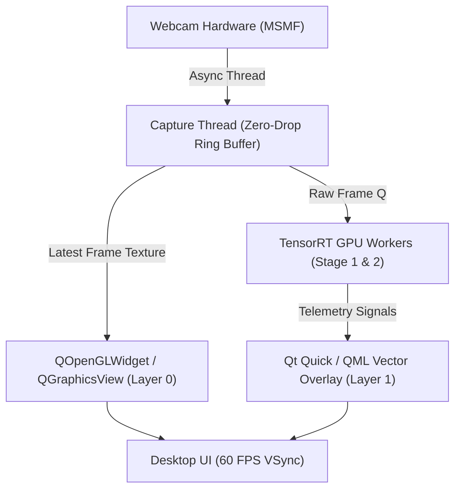
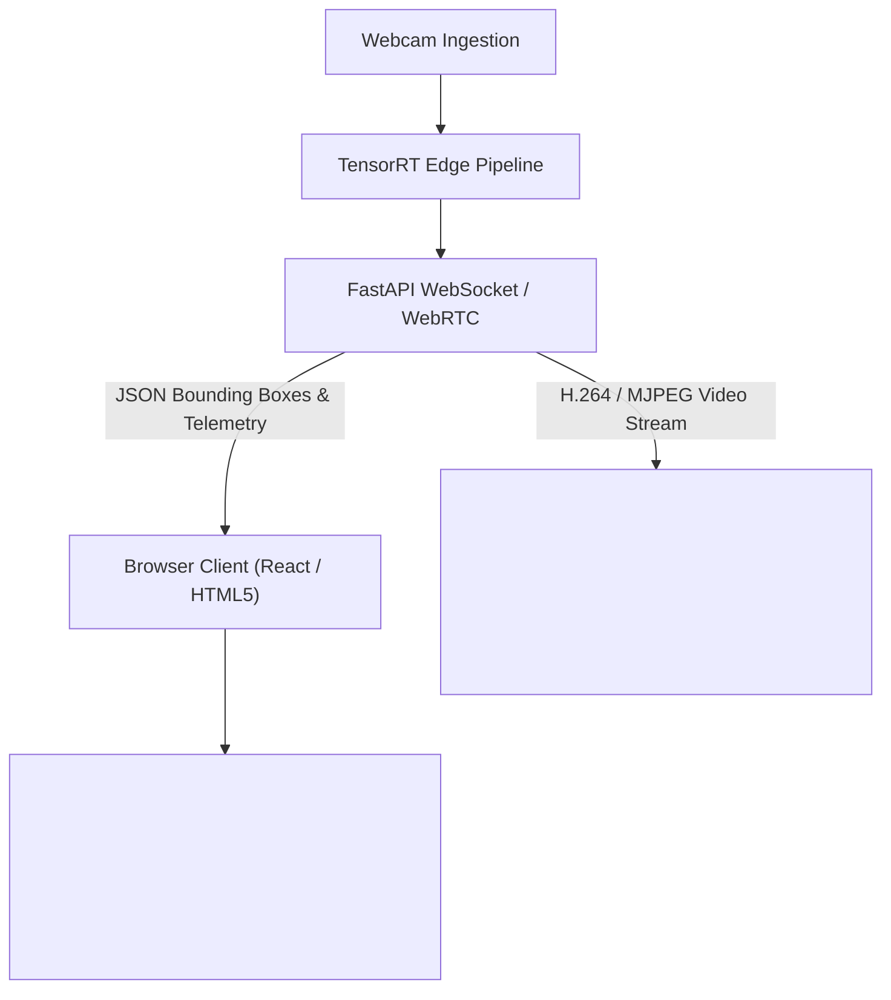

# Technical Report & Architectural Audit: OpenCV Ingestion, HUD Bottlenecks, and UI Decoupling

**Project:** Hierarchical Edge-AI Threat & Violence Detection System  
**Hardware Profile:** NVIDIA GeForce RTX 3050 (6GB Mobile/Desktop, Ampere)  
**Target Ingestion Stream:** 1920x1440 (4:3 Aspect Ratio) @ 30.0 FPS  
**Date:** October 2026  

---

## 1. Executive Summary

This investigation was triggered by an unexpected performance ceiling where a high-capability TensorRT surveillance pipeline running on an NVIDIA RTX 3050 GPU was throttled to **15.1 FPS**, later improving to **23.3 FPS**, despite the GPU being virtually idle (0% utilization, 4W power draw).

This audit identifies the exact mechanical root causes across two layers:
1. **Camera Sensor Ingestion Negotiation** (Driver backend prioritization).
2. **OpenCV Monolithic GUI Anti-Pattern** (Synchronous capture, full-frame CPU pixel manipulation, and OS timer granularity).

This document serves as the technical specification and refactoring guide for transitioning from legacy OpenCV pixel-burning to a production-grade decoupled UI architecture.

---

## 2. Forensic Analysis: The Three Framerate Ceilings


### 2.1 The 15.1 FPS Floor: DirectShow Driver Negotiation
* **Mechanism:** In [`src/inference_production_pipeline.py`](file:///d:/Code/hierarchical-threat-detection-edge-ai/src/inference_production_pipeline.py), the camera initialization loop prioritized `cv2.CAP_DSHOW` ahead of `cv2.CAP_MSMF`.
* **The Glitch:** When `2560x1440` was requested with FourCC `'MJPG'`, the legacy Windows DirectShow driver selected an internal media profile locked to **15.00 FPS**.
* **Fix Applied:** Inverted backend priority to `[cv2.CAP_MSMF, cv2.CAP_DSHOW, cv2.CAP_ANY]` and explicitly negotiated `c.set(cv2.CAP_PROP_FPS, 30)`. Windows Media Foundation successfully unlocked **30.31 FPS** raw sensor streaming.

### 2.2 The 23.3 FPS Ceiling: Monolithic Main Thread Overhead
Even after unlocking 30 FPS at the driver level, the live pipeline stalled at **23.3 FPS** (~42.9 ms per frame). Profiling isolated **~18.8 ms of CPU overhead per frame** inside the synchronous loop:

| Subroutine | Root Cause | Measured Latency |
| :--- | :--- | :--- |
| `cv2.waitKey(1)` | Windows default timer granularity is 15.6 ms (1/64 s). `waitKey(1)` calls Windows sleep, pausing for an entire OS tick. | **+15.02 ms** |
| `render_hud_overlay()` | Naive alpha-blending copied the entire 8.3 MB frame (`overlay = hud.copy()`) and executed `cv2.addWeighted()` across all 8.3 million values. | **+3.77 ms** |
| `cv2.imshow()` | Resampling and GDI/D3D blitting an unscaled 1920x1440 frame to a 960x720 window every tick. | **+3.50 ms** |
| `buffer.append()` | Synchronous CPU TurboJPEG encoding (`cv2.imencode`) of 1920x1440 raw frames. | **+5.08 ms** |

At $33.3\text{ ms (sensor)} + 9.6\text{ ms (unabsorbed loop overhead)} \approx 42.9\text{ ms}$, the camera driver was forced to drop frames, resulting in exactly **23.3 FPS**.

---

## 3. The Core Architectural Flaw: The OpenCV UI Anti-Pattern

OpenCV (`cv2.imshow`) was engineered in 1999 as a lightweight C testing harness for computer vision algorithms, not as an interactive GUI application framework.

### Why OpenCV Fails as a Production Surveillance UI:
1. **No Layer Separation:** There is no concept of a separate "overlay" plane. To draw a bounding box or status card, the code must physically overwrite and mutate pixel values inside the raw BGR NumPy image array on the CPU.
2. **Pseudo-Transparency Overhead:** Because OpenCV shapes lack an alpha channel, achieving transparency requires manual mathematical blending ($img_1 \times \alpha + img_2 \times \beta$). Copying entire 2K/4K frames to darken a small card wastes millions of clock cycles.
3. **Synchronous Blocking Event Loop:** `cv2.imshow()` and `cv2.waitKey()` block the main thread. If rendering stutters, video capture drops frames.
4. **No Modern Controls:** Cannot host buttons, tabs, sliders, toggles, or resizable vector graphics.

---

## 4. Code Inventory: OpenCV References Requiring Refactoring

Below is the complete inventory of OpenCV (`cv2`) invocations across the codebase that should be replaced or decoupled:

### Category A: Window Management & Display Loop
*Files:* [`src/inference_production_pipeline.py`](file:///d:/Code/hierarchical-threat-detection-edge-ai/src/inference_production_pipeline.py), [`src/inference_realtime_v1.04.py`](file:///d:/Code/hierarchical-threat-detection-edge-ai/src/inference_realtime_v1.04.py)

```python
# TARGETS TO REMOVE / REPLACE:
cv2.namedWindow(win_title, cv2.WINDOW_NORMAL)
cv2.resizeWindow(win_title, 960, 720)
cv2.imshow(win_title, hud)
cv2.waitKey(1)
cv2.destroyAllWindows()
```
* **Problem:** Monolithic loop; locks UI refresh rate directly to camera capture speed; prone to Windows OS timer jitter.

### Category B: HUD Graphics & Drawing Primitives
*Files:* [`src/inference_production_pipeline.py`](file:///d:/Code/hierarchical-threat-detection-edge-ai/src/inference_production_pipeline.py#L296-L365)

```python
# TARGETS TO REMOVE / REPLACE:
cv2.putText(hud, text, (x, y), cv2.FONT_HERSHEY_SIMPLEX, scale, color, th, cv2.LINE_AA)
cv2.getTextSize(text, font, scale, th)
cv2.rectangle(hud, (x1, y1), (x2, y2), color, thickness)
cv2.addWeighted(...)
```
* **Problem:** Direct pixel mutation in CPU memory. Bounding boxes and badges are burned destructively into the frame rather than rendered on a hardware-accelerated vector overlay.

### Category C: Camera Ingestion
*Files:* [`src/inference_production_pipeline.py`](file:///d:/Code/hierarchical-threat-detection-edge-ai/src/inference_production_pipeline.py#L250-L280)

```python
# TARGETS TO RESTRUCTURE:
cap = cv2.VideoCapture(idx, cv2.CAP_MSMF)
cap.set(cv2.CAP_PROP_FOURCC, cv2.VideoWriter_fourcc(*'MJPG'))
cap.set(cv2.CAP_PROP_FPS, 30)
ret, frame = cap.read()
```
* **Problem:** `cap.read()` blocks synchronously in the consumer thread. If downstream tasks take >33 ms, frames drop. Must be converted into a non-blocking threaded producer-consumer queue.

### Category D: In-Memory Ring Buffer Compression
*Files:* [`src/pipeline_buffer.py`](file:///d:/Code/hierarchical-threat-detection-edge-ai/src/pipeline_buffer.py#L33-L48)

```python
# TARGETS TO EVALUATE:
cv2.imencode(".jpg", frame, encode_params)
cv2.imdecode(self.jpeg_data, cv2.IMREAD_COLOR)
```
* **Problem:** Pure CPU JPEG encoding. At 1920x1440, synchronous `imencode` takes ~5-12 ms per frame. Should be offloaded to a background thread or replaced with hardware NVENC / TurboJPEG C-bindings.

---

## 5. Architectural Blueprints for the Expert AI

To transition to an industrial, decoupled architecture, choose between two primary paradigms:

### Option 1: Desktop Application (PySide6 / Qt6 + Hardware OpenGL)
*Best for: Native on-premise desktop surveillance workstation.*



* **Layer 0 (Video Surface):** `QOpenGLWidget` or `QQuickItem` renders camera frames directly as GPU textures via OpenGL/DirectX.
* **Layer 1 (HUD Overlay):** Pure QML/CSS vector UI. Text, translucent cards, badges, and bounding boxes float above the video with zero CPU pixel copying.
* **Decoupled Capture:** Capture thread drains webcam at native 30/60 FPS into `ThreadSafeCircularBuffer`. UI renders at display VSync (60/144 Hz) independently.

### Option 2: Modern Headless Web Streamer (FastAPI + WebRTC / MJPEG + HTML5 Canvas)
*Best for: Modern cloud/edge CCTV deployments (Jetson, server, browser monitoring).*



* **Zero Desktop UI Overhead:** The edge device runs purely headless with maximum compute dedicated to TensorRT.
* **Client-Side HUD Rendering:** The browser renders the translucent glass cards, bounding boxes, and alert telemetry using CSS and Canvas 2D/WebGL.

---

## 6. Interim Patch Reference

The following zero-regression optimizations have already been committed and pushed to `main` (`ce1d36d`) to stabilize 30 FPS while the larger UI refactor is underway:

1. **`CAP_MSMF` Prioritization:** Resolved the 15 FPS DirectShow driver lock.
2. **`timeBeginPeriod(1)`:** Restored Windows timer resolution, slashing `cv2.waitKey(1)` from 15.02 ms to 1.64 ms.
3. **ROI-Only Card Blending:** Replaced whole-frame copying with `hud[y1:y2, x1:x2]` in-place blending, slashing overlay render time from 3.77 ms to 0.03 ms.
